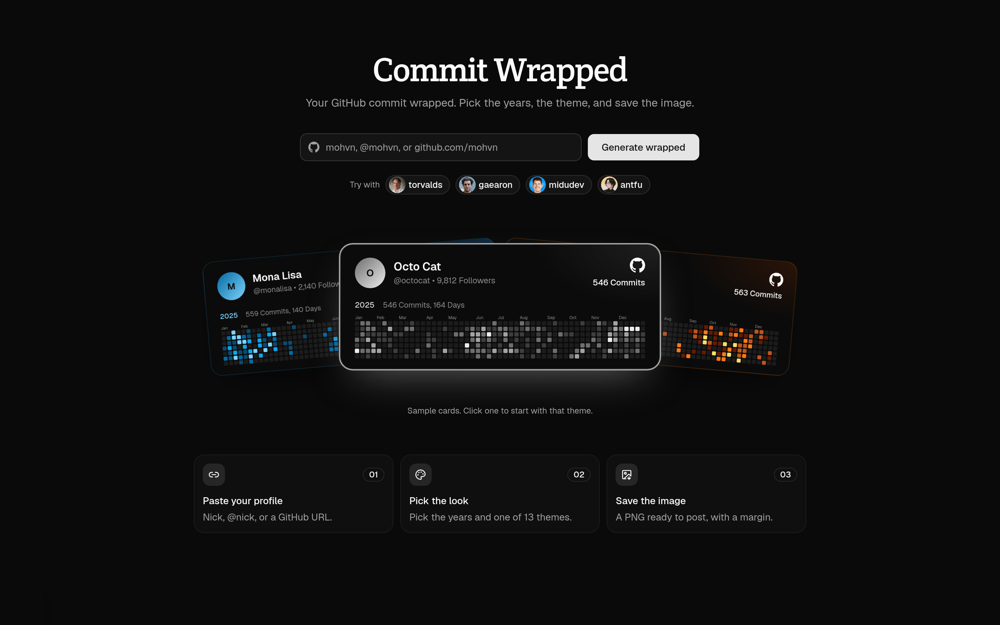

# Commit Wrapped

Paste a GitHub nick or URL and generate a yearly commit wrapped. Pick the years, a theme, and save the image.



## Run locally

```bash
bun install
bun dev
```

Open [http://localhost:3000](http://localhost:3000).

Set `GITHUB_TOKEN` if GitHub rate-limits anonymous requests.
